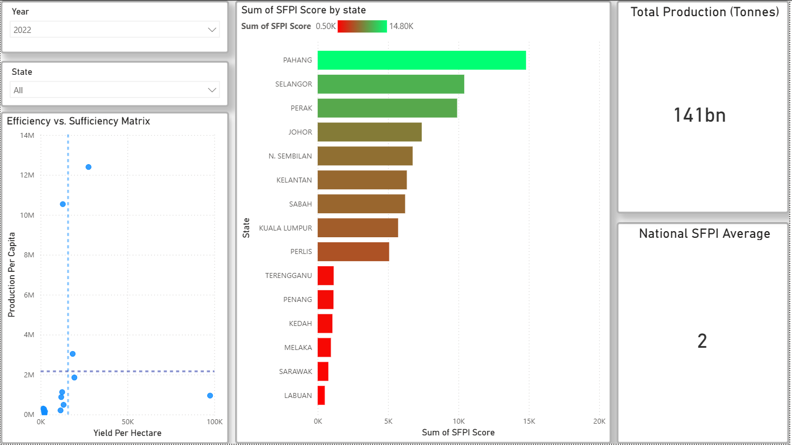

# Data-Driven Optimization of Crop Production for Sustainable Well-Being

A data analytics and visualization project developed by **Team Data Dynamos** for **Data Challenge 5.0 (UKM)**, aligned with **UN SDG 3 (Good Health & Well-Being)** and **SDG 12 (Responsible Consumption & Production)**.

## Project Overview
Raw crop production totals fail to capture true agricultural efficiency across Malaysian states due to differences in arable land and population density. To solve this, we engineered the **Sustainable Food Production Index (SFPI)** to evaluate state-level land productivity and food sufficiency, enabling targeted agricultural policy interventions.

## Methodology & SFPI Framework
1. **Data Preparation:** Cleaned and standardized state-level datasets using Python (`pandas`, `scikit-learn`) to resolve naming mismatches and merge agricultural output with demographic figures.
2. **Feature Engineering:**
   - **Yield Efficiency:** Tonnes per Hectare (measures land productivity)
   - **Sufficiency Ratio:** Tonnes per Capita (measures food availability)
   - **SFPI Score:** Combined index integrating both metrics to benchmark state performance.
3. **Quadrant Analysis:** Segmented states using an Efficiency vs. Sufficiency scatter matrix to isolate high-performing models and critical intervention zones.

## Interactive Dashboard (Power BI)
The Power BI dashboard (`dashboard/Data Challenge 5.0.pbix`) features:
- **Dynamic Slicers:** Filter performance by Year and State.
- **KPI Summary Cards:** National SFPI Average and Total Crop Production.
- **State Leaderboard:** Conditionally formatted ranking highlighting top performers (e.g., Pahang, Perak, Selangor) and critical deficit zones (e.g., Labuan, Sarawak, Melaka).
- **Efficiency vs. Sufficiency Matrix:** Four-quadrant scatter plot identifying low-yield, low-sufficiency states requiring precision farming or urban agriculture support.

> **[Watch the Interactive Demo / Presentation Video](https://youtu.be/cHuHtMOHLsE)**

## Repository Structure
- `data/` – Raw OpenDOSM datasets and processed SFPI dataset
- `scripts/` – Python data cleaning and SFPI calculation scripts
- `dashboard/` – Power BI (`.pbix`) file and exported PDF report
- `docs/` – Final presentation slides and A3 infographic poster

## Tech Stack
- **Data Processing:** Python, Pandas, Scikit-learn
- **Visualization:** Microsoft Power BI

## Data Sources & References
- Department of Statistics Malaysia (DOSM) – [Crop Area and Production by State](https://open.dosm.gov.my/data-catalogue/crops_state)
- Department of Statistics Malaysia (DOSM) – [Population Table: States](https://open.dosm.gov.my/data-catalogue/population_state)
- Ministry of Agriculture and Food Industries (MAFI) – *National Agrofood Policy 2021–2030 (NAP 2.0)*
- United Nations – *2030 Agenda for Sustainable Development (SDG 3 & SDG 12)*